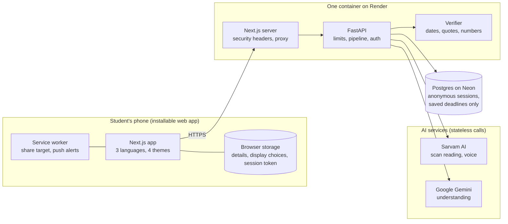
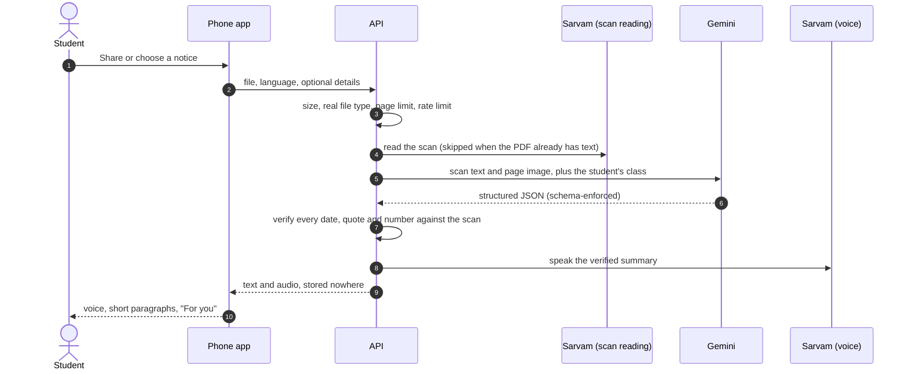
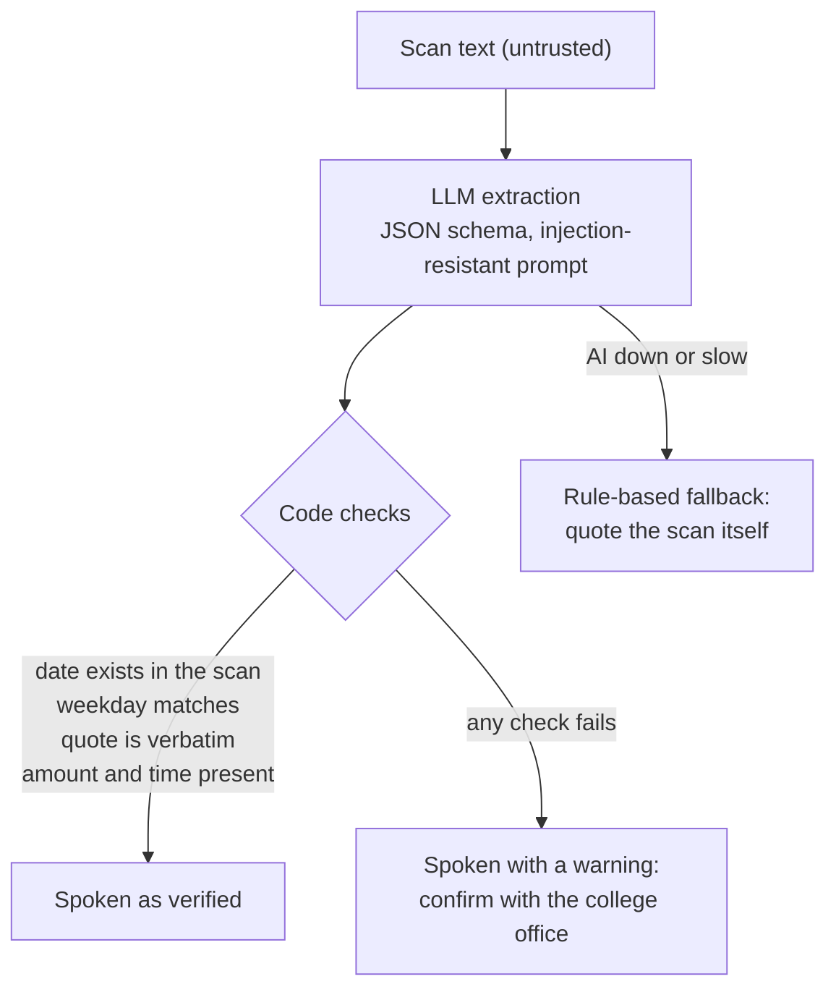
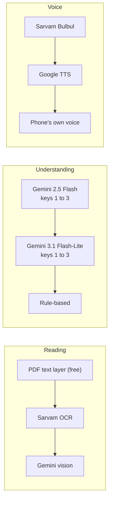

# Saathi Campus

**Every college notice, read aloud and checked, in English, Hindi and Marathi.**
Built for blind, low-vision and dyslexic students by team **MolecuLens** for the Naya Bharat 2047 hackathon, problem 5.3: *a notice the screen reader cannot read*.

> **Try it now, no setup:** open the live app on an Android phone, tap **Start**, choose any notice (photo or PDF), and listen.
> Live demo: https://temp-6vp3.onrender.com/me (free hosting: the first request after a pause can take a minute).

---

## The problem

Colleges publish notices as **scanned images and PDFs**. A screen reader cannot read a picture, so a blind student misses exam dates, fee deadlines and seating details that every other student sees in seconds.

| Evidence | Source |
|---|---|
| Scanned PDFs cannot be read by a screen reader; most West Bengal board textbooks are uploaded that way | [NCERT e-textbook study](https://www.inkl.com/news/half-of-ncert-e-textbooks-not-accessible-to-visually-impaired-finds-study) |
| 51.6% of visually impaired University of Delhi students found their college website hard to use because it ignores accessibility standards | [Information systems for the visually impaired in Indian universities](https://emerald.com/insight/content/doi/10.1108/IDD-05-2021-0053/full/html) |
| Blind users in India are overwhelmingly on Android (iOS is about 2% of the market) and rely on TalkBack and WhatsApp | [Microsoft Research, CHI 2021](https://homes.cs.washington.edu/~mohitj/pdfs/c32-chi-2021.pdf), [Delhi case reports](https://pmc.ncbi.nlm.nih.gov/articles/PMC9299074) |

Saathi starts from those facts: **Android-first, TalkBack-first, no app store, no account, nothing for the college to adopt.**

## What it does

1. **Read a notice to me.** Share a photo or PDF (or pick one). Saathi reads it, checks every date against the scan, and speaks a short summary in the student's language.
2. **For you.** The student saves their class, division or roll number **on their own phone**. Saathi then says what applies to *them* in a 40-page seating or timetable PDF.
3. **Remember a deadline.** Say what the teacher said in class. Saathi reads the date back, and saves it only after the student confirms.
4. **Made to be read by everyone.** One task per screen, huge buttons, four colour themes, three text sizes, wide-spacing mode, and the whole interface in three languages.

## Why Saathi (what is different)

| | What we built | Why it matters |
|---|---|---|
| **1. Zero-trust AI** | The language model is treated as an *untrusted assistant*. Every date, weekday, amount, time and quoted line it returns is re-checked **in code** against the scan before it is spoken. Anything that fails is spoken with a warning, never as fact. | A wrong exam date can cost a student a semester. "The AI said so" is not an answer. |
| **2. Privacy by design** | Notice text, summaries, audio and the student's details are **never stored**. The student's details live in the browser and travel only inside the single request that needs them. Caches are bypassed for personal reads. | Seating lists contain other students' names. We cannot leak what we never keep. |
| **3. On-device personalisation** | No accounts, no profiles on a server. | Personal answers without personal data collection. |
| **4. Graceful degradation** | Three layers of fallback for reading, understanding and speaking, per-provider circuit breakers, multi-key and multi-model failover, and a rule-based mode that quotes the scan itself if every AI is down. | During testing the main AI quota ran out. The student still got an answer. |
| **5. Indic-first** | Marathi and Hindi documents (Devanagari digits, bilingual notices, HTML tables from scans) are first-class, not an afterthought. Interface, voice, dates and errors are localised. | The students this is for read Marathi and Hindi notices. |
| **6. Accessible by construction** | WCAG 2.2 AAA palettes verified by computed contrast ratios, 44px+ targets, focus management, and an automated test that runs axe (including AAA rules) over every screen in every theme and size. | Accessibility is a property of the build, not a checklist at the end. |
| **7. Cost-aware** | A hard budget cap on paid AI, free text-layer PDF reading, caching on the staff path, and a measured cost of roughly ₹2 per notice (from configured rates). | Sustainable for a Rotaract club to run. |
| **8. Tested like a product** | 116 automated tests (flow, failure injection, performance, security, personal insight) plus the accessibility test. | Behaviour is proven, not promised. |

## How it works

### System architecture



### One notice, end to end



### Where the AI is *not* trusted



### Failover chains



## Technology and why

| Layer | Choice | Why this, and why not the alternative |
|---|---|---|
| App | Next.js 15 and React 19, installable PWA | One codebase, installs from a link, supports Android's Share menu, and TalkBack reads it natively. *Not native:* weeks of work, store review, and every control would need labelling by hand. |
| API | FastAPI (async Python) | The work is waiting on AI services, which async handles well; typed models validate every input. *Not Django:* heavier and synchronous for this shape of work. |
| Reading and voice | Sarvam AI | Built for Indian languages and Devanagari scans. |
| Understanding | Google Gemini with schema-enforced JSON | Structured output plus vision for tables and stamps. Used behind a verifier, never trusted alone. |
| Database | Postgres (Neon) in production, SQLite locally, one SQLAlchemy codebase | Same code on both; free tier survives restarts. |
| Hosting | One Docker container on Render | Free, simple, identical to what we test. *Not microservices:* overkill for one team and one student-facing flow. |
| Channel | Web app first | WhatsApp would need Meta business verification and unofficial libraries break its terms; the code for it exists and is switched off. |

Full reasoning, including the trade-offs we accepted: [docs/DECISIONS.md](docs/DECISIONS.md).

## Security at a glance

| Area | Control |
|---|---|
| Input | 15 MB limit, real file type from the first bytes (not the file name), page caps, password-protected PDFs refused, per-student and per-client rate limits |
| AI | Untrusted-data prompts, schema-bound output, every claim re-verified, student details sanitised, timeouts and circuit breakers |
| Identity | Signed, expiring student tokens; no passwords; staff tokens stored hashed; first-time setup and sign-up can be locked with a setup token and an access code |
| Data | Nothing about a read is stored; personal responses are `no-store`; phone numbers (staff and WhatsApp path only) are hashed and encrypted |
| Browser | Strict Content-Security-Policy, no framing, no referrer, microphone limited to this site, HSTS |
| Secrets | Only in environment variables, never in the repository; production refuses to start without real keys. GitHub's secret scanner already blocked one accidental key before it left the laptop. |

Details, threat model and known gaps: [docs/SECURITY.md](docs/SECURITY.md).

## Accessibility

Targets **WCAG 2.2 AAA** where it applies, with **GIGW 3.0** (Indian government web guidelines) and **British Dyslexia Association** advice as references. Four palettes, every text pair at least 7:1 contrast (computed, not estimated). Tested with axe (including AAA rules), keyboard walks and the accessibility tree in English, Hindi and Marathi. It is **not formally certified**, and automated tests do not replace a real TalkBack session. Details: [docs/ACCESSIBILITY.md](docs/ACCESSIBILITY.md).

## Run it yourself

Skip this section if you only want to try the live app above.

```bash
# 1. Backend
cd code/backend
python -m venv .venv && source .venv/bin/activate        # Windows: .venv\Scripts\activate
pip install -r requirements-dev.txt
cp .env.example .env        # add SARVAM_API_KEY and GEMINI_API_KEY; everything else has defaults
uvicorn app.main:app --port 8001

# 2. Frontend (new terminal)
cd code/frontend
npm ci
echo "BACKEND_URL=http://localhost:8001" > .env.local
npm run build && npm start   # open http://localhost:3000/me
```

Run the tests:

```bash
cd code/backend && pytest -q                       # 116 tests
cd code/frontend && node scripts/a11y-student.mjs  # accessibility, needs Chrome and the app running
```

`ffmpeg` is needed for voice notes and a few tests. Deployment: [docs/DEPLOYMENT.md](docs/DEPLOYMENT.md).

## Project structure

```
saathi-campus/
├─ README.md                 you are here
├─ docs/                     architecture, security, decisions, accessibility, judges' Q&A, study guide
├─ scripts/                  export-submission.ps1: copy the code into another repository
└─ code/
   ├─ Dockerfile, start.sh   one container: API plus website
   ├─ backend/
   │  ├─ app/routers/        HTTP endpoints. Student ones are always on; the college side is off by default
   │  ├─ app/pipeline/       the logic: date verification, personal insight, jobs, notifications
   │  ├─ app/providers/      one adapter per outside service (OCR, AI, voice, push, WhatsApp)
   │  └─ tests/              116 tests
   └─ frontend/
      ├─ app/me/             the student app
      ├─ app/about/          privacy, AI tools, accessibility statement
      ├─ app/desk/           staff desk: kept in the code, switched off (COLLEGE_MODE)
      ├─ lib/                translations, display choices, API client
      └─ scripts/            accessibility test
```

## Honest limits and what is next

- **Student-facing only, by design.** The college side (staff desk, publishing, walkthroughs, WhatsApp) is kept in the code but switched off. Set `COLLEGE_MODE=true` on the API and `NEXT_PUBLIC_COLLEGE_MODE=true` at build to bring it back. While off, none of those endpoints exist.
- **Not yet tested with a real blind student.** Automated and eyes-closed testing are done; a consented session with a blind or low-vision student is the next milestone.
- **Single-instance design.** The job queue and rate limiter live in the API process. Going beyond one instance means a shared queue and cache (documented in [docs/ARCHITECTURE.md](docs/ARCHITECTURE.md)).
- **No database migrations yet.** Tables are created on start; a migration tool comes before any schema change in production.
- **AI quota.** Free tiers are small. Multiple keys and a fallback model absorb this; a paid tier removes it.
- **Very long or blurry scans** can be slow or partial, and Saathi says so.
- **Next:** a real-user study, WhatsApp delivery once business verification is possible, more Indian languages, calendar reminders, a revision and quiz mode for lecture notes.

## Team, tools and credits

**Team MolecuLens.** Made for the Naya Bharat 2047 hackathon. This is an independent student project and is not endorsed by Rotary or Rotaract.

AI services used **in the product**: Sarvam AI (scan reading, voice) and Google Gemini (understanding). Hosting: Render and Neon. Development was assisted by an AI coding assistant; every behaviour is covered by automated tests and reviewed by the team.
