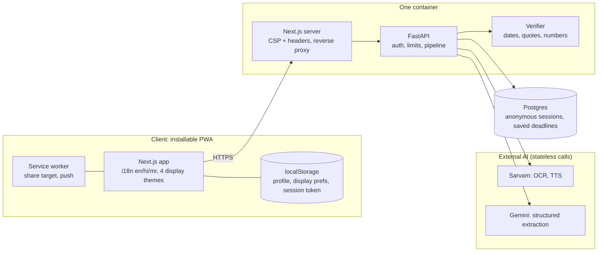
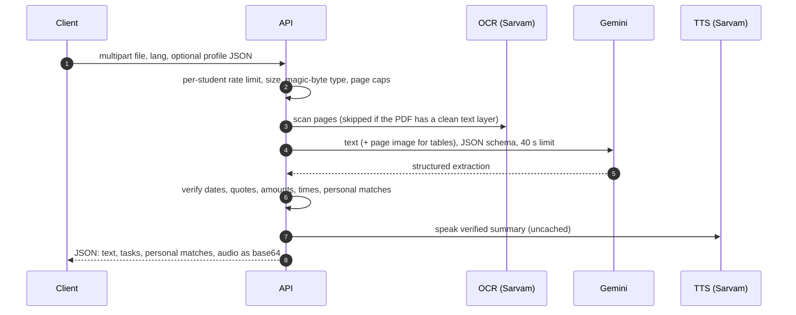
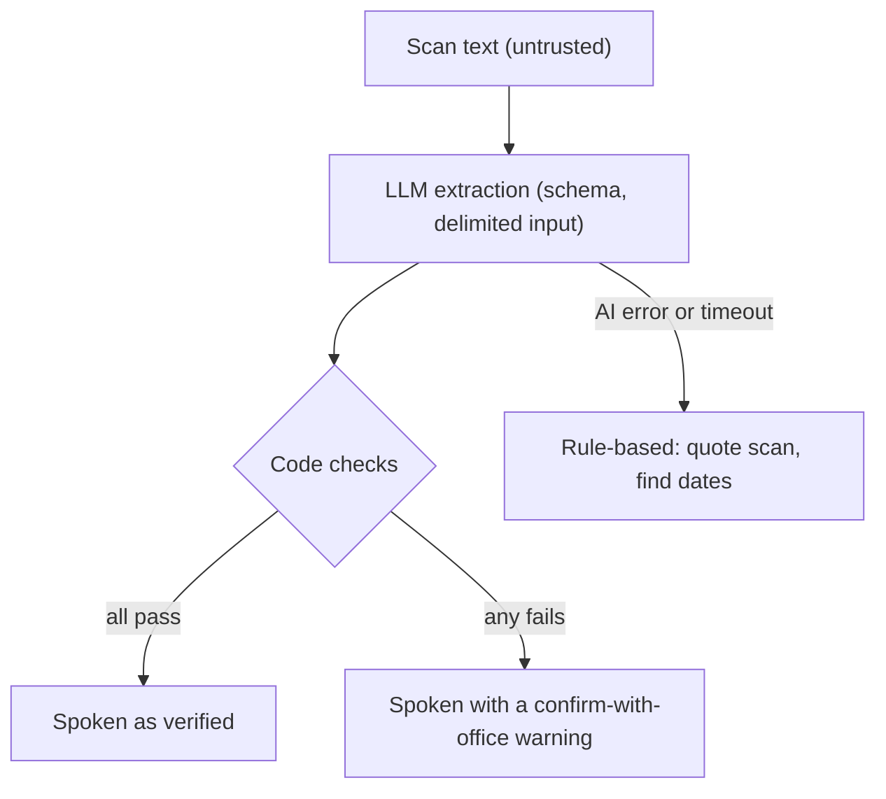
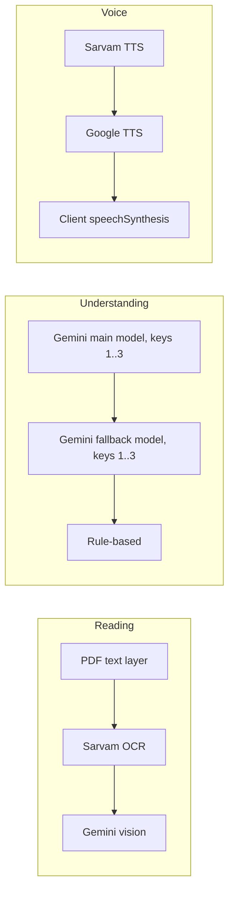

# Samyukta

Installable web app that reads a scanned college notice (photo or PDF) aloud in English, Hindi or Marathi, and verifies every date against the scan before speaking it. Student-facing, accountless, and stateless for reads.

Stack: Next.js 15 / React 19 (PWA) · FastAPI (async) · SQLAlchemy · Postgres (SQLite locally) · Sarvam AI · Google Gemini · Docker.

---

## 1. Architecture



One container, two processes: Next.js (public port) proxies `/api`, `/media`, `/health` to FastAPI on `127.0.0.1:8001`. The browser sees one origin: no CORS, one TLS termination, one place for security headers.

**Layering:** `routers/` (HTTP only) → `pipeline/` (logic, no framework imports) → `providers/` (one adapter per vendor). Tests swap whole providers for fakes.

## 2. Read-a-notice request

`POST /api/me/read` (`app/routers/me.py`: `read_notice`, `_read_notice`)



| Step | Detail |
|---|---|
| Input checks | 15 MB cap, files < 200 bytes refused, type from the first bytes (`sniff_mime`), password-protected PDFs refused (`pdf_locked`) |
| Page limits | Scans: `MAX_PDF_PAGES` (10). PDFs with a text layer on first, middle and last pages: `MAX_TEXT_PDF_PAGES` (40). A "text" PDF that fails `pdf_text_layer` is re-cut to the scan limit, so cost is always bounded |
| Reading | `pdf_text_layer` → Sarvam OCR → Gemini vision. Called with `cache=False` |
| Extraction | `gemini_extract`: schema-enforced JSON (`NoticeExtraction`, or `NoticeExtractionPersonal` with a profile). Tables and date sheets also send the page (photos always; PDFs up to 4 pages) |
| Failover | Per (model, key) circuit breaker. Order: all keys of the main model, then all keys of the fallback model. Quota (429) and overload (503) skip to the next without retrying |
| Time bound | `asyncio.wait_for(…, 40)` so the host's ~100 s request limit is never reached; on timeout the rule-based fallback quotes the scan |
| Speech | `speak_uncached`: Sarvam → Google TTS → none (client uses the phone's own voice). Audio is returned inline, never written |
| Concurrency | `Semaphore(2)`, sized for 512 MB |

## 3. Verification (the trust boundary)

The model is an untrusted proposer. `pipeline/dates.py::verify_action` accepts an action only if:

- its `source_quote` is found in the scan (token-level; any digit-bearing token must match exactly);
- the date exists in the scan text, parsed day-first, with Devanagari digits and Marathi/Hindi month names;
- a written weekday agrees with the date;
- amount and time strings appear in the scan;
- the date is not more than 7 days in the past or more than 400 days ahead.



The spoken summary is checked too: any date in it must exist in the scan and any weekday must match.

**Personal insight** (`pipeline/profile.py`). The profile arrives as a request field and is never persisted. `parse_profile` strips markup and control characters and caps lengths. `focus_text` keeps the first page plus ±500 characters around the student's roll number or name, for documents over 18,000 characters. `verify_personal` keeps a model claim only if the quoted line is in the scan, names the student's roll number / name / class, and every number in the detail appears in that line. A rule-based fallback quotes lines containing the roll number or name.

## 4. Resilience



Circuit breakers and retries: `providers/base.py`. Paid-call budget ledger (`reserve_budget` / `refund_budget`) enforces `SARVAM_BUDGET_PAISE`.

## 5. API (student path)

| Method and path | Purpose |
|---|---|
| `POST /api/public/join` | Create an anonymous student, return a signed token. Optional `DEMO_ACCESS_CODE` |
| `POST /api/me/read` | Read a notice (above) |
| `POST /api/me/catch`, `/catch/{id}/confirm`, `/catch/{id}/cancel` | Spoken deadline: read-back, then confirm |
| `GET /api/me/deadlines`, `GET /api/me/inbox` | Saved deadlines |
| `GET/PUT /api/me/buzz-codes`, `POST /api/me/push/subscribe` | Vibration patterns, Web Push |
| `GET /media/{key}` | Audio (staff path only) |
| `GET /health`, `GET /ready` | Liveness, readiness |

Auth: `?t=<token>`; HMAC-signed, expiring (`security.py`). Errors share one shape: `{error: {code, message, detail}}`.

## 6. Data model and privacy

| Table | Student path | Notes |
|---|---|---|
| `student` | random id, language | Web students carry a random placeholder, no phone, no name |
| `personal_deadline` | only deadlines the student saves | |
| `provider_usage` | provider, units, latency | No content. Feeds the spend cap |
| `ocr_cache`, `audio_cache` | **not used** by student reads | Staff path only |

Not stored: the notice, its text, the summary, the audio, the profile. Personal responses carry `Cache-Control: no-store`. Logs hold method, path, status, duration and a request id.

## 7. Security controls

| Area | Control | Tested |
|---|---|---|
| Transport/browser | Strict CSP (`default-src 'self'`, no framing, `object-src 'none'`), `nosniff`, `X-Frame-Options: DENY`, `Referrer-Policy: no-referrer`, `Permissions-Policy` (microphone self only), HSTS in prod | yes |
| Identity | HMAC-signed expiring tokens; tampered tokens rejected; ownership checks return 404 for foreign records | yes |
| Abuse | Per-student read limit (6/min), per-client join limit (40/min), optional access code, 15 MB cap, magic-byte typing, page caps, spend cap | yes |
| AI | Delimited untrusted input, schema-bound output, code re-verification, sanitised profile | yes |
| Secrets | Env vars only; `.env` ignored by git and Docker; prod refuses to start with default `SECRET_KEY` or missing `PHONE_ENCRYPTION_KEY` | yes |
| Attack surface | The college side (staff desk, publishing, walkthroughs, WhatsApp webhook) is not mounted unless `COLLEGE_MODE=true`. With it off, the admin-setup endpoint does not exist | yes |

Known gaps: CSP allows `'unsafe-inline'` scripts (Next.js bootstrap; nonce-based CSP is the next step); rate limits are in-memory and per instance; no external penetration test.

## 8. Accessibility engineering

- Four palettes as CSS custom properties on `html[data-look]`, computed contrast: body text ≥ 13.9:1, muted text ≥ 8.6:1, links ≥ 9.1:1, control edges ≥ 4.5:1, high-contrast theme 21:1.
- Display state (look, size, spacing) is applied by the shared `Screen` component on every screen and persisted in `localStorage`.
- One focused `<h1>` per screen (hash routes), real `<button>` controls, a custom player (play/pause, −10 s, speed), 44 px minimum targets, `aria-pressed` on toggles, `lang` on translated regions.
- `scripts/a11y-student.mjs` drives Chrome through every student screen in 4 themes × 2 sizes: axe (WCAG 2.0/2.1/2.2 + AAA rules), keyboard walk (name and focus ring on every stop), 44 px target check, focus-on-title check.

## 9. Tests

`cd code/backend && pytest -q` runs 118 tests:

| File | Covers |
|---|---|
| `test_flow`, `test_campus`, `test_personal` | End-to-end flows through real HTTP, DB and job queue |
| `test_dates` | Date parsing and verification |
| `test_failures` | Injected provider outages, quota errors, malformed AI output |
| `test_perf` | Latency and call-count budgets |
| `test_profile` | Profile sanitising, focusing, personal verification, page-limit logic, the no-storage guarantees |
| `test_security` | Headers, tokens, ownership, access code, upload and rate limits |
| `test_college_mode` | College side absent when off, present when on |

CI (`.github/workflows/ci.yml`): backend tests and `ruff`, frontend `tsc --noUnusedLocals` and build.

## 10. Configuration

| Variable | Purpose |
|---|---|
| `ENV` | `dev` or `prod` (prod enforces secrets) |
| `DATABASE_URL` | Postgres URL in prod (`sslmode` handled); SQLite default locally. **Required in prod**, else data is lost on restart |
| `SECRET_KEY`, `PHONE_ENCRYPTION_KEY` | Token signing, field encryption |
| `SARVAM_API_KEY`, `SARVAM_BUDGET_PAISE` | OCR and TTS, spend cap |
| `GEMINI_API_KEY`, `GEMINI_API_KEY_2`, `GEMINI_API_KEY_3`, `GEMINI_MODEL`, `GEMINI_FALLBACK_MODELS` | Extraction and failover |
| `MAX_PDF_PAGES`, `MAX_TEXT_PDF_PAGES`, `MAX_UPLOAD_MB` | Input bounds |
| `DEMO_ACCESS_CODE` | Optional sign-up code |
| `VAPID_*` | Web Push |
| `COLLEGE_MODE`, `NEXT_PUBLIC_COLLEGE_MODE` | Mount the college side (API / website). Default off |

Full list: `code/backend/app/config.py`, `code/backend/.env.example`.

## 11. Run, test, deploy

```bash
# backend
cd code/backend && python -m venv .venv && source .venv/bin/activate   # Windows: .venv\Scripts\activate
pip install -r requirements-dev.txt && cp .env.example .env            # set SARVAM_API_KEY, GEMINI_API_KEY
uvicorn app.main:app --port 8001

# frontend
cd code/frontend && npm ci && echo "BACKEND_URL=http://localhost:8001" > .env.local
npm run build && npm start                                              # http://localhost:3000/me

# checks
cd code/backend && pytest -q && ruff check --select F app tests scripts
cd code/frontend && npx tsc --noEmit --noUnusedLocals && node scripts/a11y-student.mjs
```

`ffmpeg` is required for voice-note conversion and some tests. Deployment (Render and Neon): `docs/DEPLOYMENT.md`.

## 12. Repository layout

```
.
├─ code/
│  ├─ Dockerfile, start.sh        one container: API + website
│  ├─ backend/
│  │  ├─ app/routers/             HTTP (student always on; college side behind COLLEGE_MODE)
│  │  ├─ app/pipeline/            dates.py (verifier), profile.py, jobs, notifications
│  │  ├─ app/providers/           ocr, llm, tts, stt, media, webpush, whatsapp, base (breakers)
│  │  └─ tests/
│  └─ frontend/
│     ├─ app/me/                  student app (Shell, ReadScreen, SettingsScreen, Welcome, StudentApp)
│     ├─ app/about/               privacy, AI tools, accessibility statement
│     ├─ app/desk, app/routes, app/r/   college side (off by default)
│     ├─ lib/                     i18n, display prefs, API client
│     └─ scripts/                 a11y-student.mjs
├─ docs/                          architecture, security, decisions, deployment
└─ scripts/export-submission.ps1  copy tracked files into another repository
```

## 13. Limits

- Job queue and rate limiter are in-process: single instance. Scaling needs a shared queue and store, a migration tool (tables are created at start), and object storage for the staff path.
- AI quotas are the first scaling limit; keys and a fallback model absorb it.
- A date written without a year in a range ("1 February to 10 March 2019") cannot be placed and is flagged for confirmation.
- Very long or blurry scans can be slow or partial; the response says so.
- No consented test with a blind or low-vision user yet.

Team MolecuLens. Runtime AI services: Sarvam AI (OCR, TTS) and Google Gemini. Development was assisted by an AI coding assistant; behaviour is covered by the tests above.
