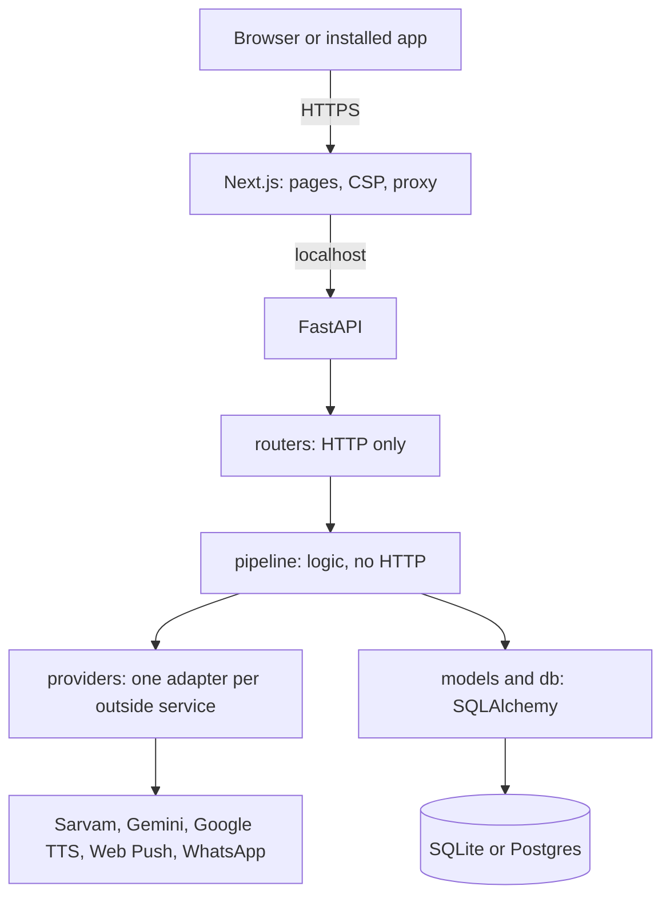

# Architecture

How Samyukta is put together, in the order a new engineer would need it.

## 1. The shape of the system

One container runs two processes: the **Next.js server** (public, port from the host) and the **FastAPI server** (private, port 8001). The website proxies `/api`, `/media` and `/health` to the API, so the browser only ever talks to one origin: no CORS, one TLS certificate, one place for security headers.

**Layering rule:** routers do HTTP (auth, validation, status codes); the pipeline holds business logic and never imports FastAPI; providers hide each vendor behind a small function so a vendor can be swapped without touching the logic. That is why the tests can replace whole vendors with fakes.

## 2. The student "read a notice" request

Code: `code/backend/app/routers/me.py` (`read_notice` and `_read_notice`).

| Step | What happens | Why |
|---|---|---|
| 1 | Rate limit per student, size and emptiness checks | Cheap rejection before any paid work |
| 2 | `_prepare`: real file type from the first bytes, page limit (text PDFs up to 40 pages, scans up to 10), refuse locked PDFs | Bounds cost and time for any upload |
| 3 | Reading: PDF text layer, else Sarvam OCR, else Gemini vision (`providers/ocr.py`), with `cache=False` | Free when possible; nothing saved |
| 4 | Understanding: Gemini returns JSON that must match a schema (`providers/llm.py`), 40 second limit, key and model failover | Structure without trust |
| 5 | Verification in code (`pipeline/dates.py`, `pipeline/profile.py`) | The trust boundary |
| 6 | Speech: `speak_uncached` (Sarvam, then Google TTS) | Audio returned inline, never stored |
| 7 | JSON back to the phone: text, tasks, "For you", audio as base64 | One round trip |

## 3. Verification: the core idea

`verify_action` (dates.py) accepts an AI-proposed task only if:

- its **quoted line** is found in the scan (token-level match, any number in the quote must match exactly);
- the **date exists in the scan text**, read in Indian day/month order, including Devanagari digits and Marathi month names;
- a **written weekday matches the date**;
- **amounts and times** appear in the scan;
- the date is not stale (over a week in the past) or implausible (over a year ahead).

For the student's own details, `verify_personal` (profile.py) additionally requires that the quoted line **names the student's roll number, name or class**, and that every number in the answer (room, bench, time) appears in that line. A claim about another student's row is dropped.

## 4. Data model (what exists)

| Table | Holds | Contains personal data? |
|---|---|---|
| `student` | Random id, language, creation time. Web students have a random placeholder instead of a phone number | No (web path) |
| `personal_deadline` | A deadline the student chose to save, with its date | Only what the student chose to save |
| `provider_usage` | Which AI service was called, units, latency, success (no content). Feeds the spend cap | No |
| `audit_event` | Staff-side actions (who approved which notice) | Staff only |
| `job` | Background work (staff path, push alerts) | No |
| `notice`, `college`, `staff_user` | The staff desk path: a college publishing its own notices | Staff names; staff tokens are hashed |
| `ocr_cache`, `audio_cache` | Staff path only. Student reads bypass them | Not used for students |

## 5. Resilience

- **Circuit breakers per provider** (`providers/base.py`): after repeated failures a provider is skipped for a cool-down instead of making every student wait.
- **Failover chains:** reading, understanding and speaking each have two or three fallbacks (see the README diagram). Understanding fails over across *keys* and *models*.
- **Hard time limit** on the AI step so the host's request cut-off (about 100 seconds) is never hit; the fallback quotes the scan.
- **Concurrency limit** of two simultaneous reads, sized for a 512 MB host.
- **Budget ledger:** paid AI calls reserve money against a cap before running and refund on failure.

## 6. What changes to scale

| Today (works for a college, a club, a demo) | At 100x |
|---|---|
| Job queue and rate limiter in the API process | Shared queue (Redis) and a shared rate-limit store |
| Tables created at start-up | Migration tool before any schema change |
| One container | Several instances behind a load balancer; the API is already stateless for the student path |
| Free AI tiers | Paid tier, or per-college keys; provider quotas are the first real limit |
| Local disk for the staff path's files | Object storage (the storage layer is already behind a small interface) |

The student path was deliberately made stateless (no server session, nothing stored), so scaling it is mostly adding instances and quota.
